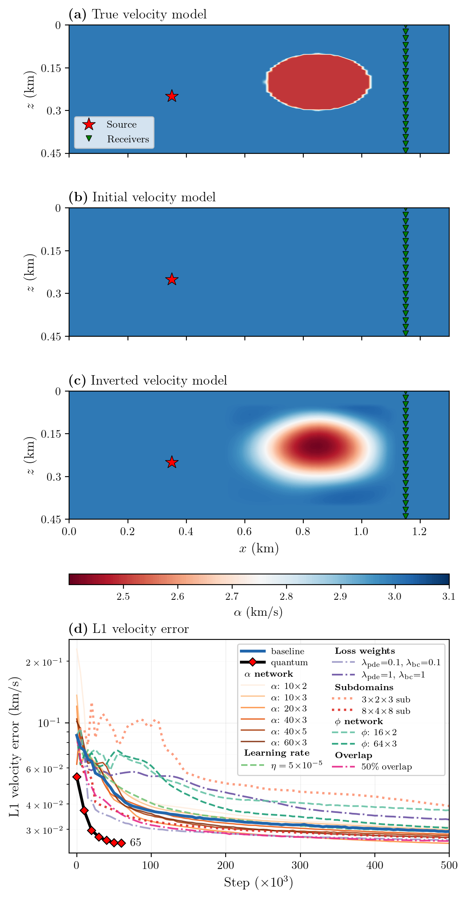

# `quFWI`: Accelerating physics-informed neural networks for full waveform inversion using a hybrid quantum-classical finite-basis architecture

Hybrid quantum-classical Full Waveform Inversion (FWI) using FBPINNs (Finite Basis Physics-Informed Neural Networks) with JAX.

## Overview

This repository implements the acoustic FWI problem using both:
- **Classical FBPINNs** (`scripts/anomaly/fwi_classical.py`) — fully connected networks
- **Quantum-hybrid FBPINNs** (`scripts/anomaly/fwi_quantum.py`) — classical layers + variational quantum circuit (PQC)

The quantum circuit implementation (`src/qufwi/pqcs/`) is a standalone JAX module with no fbpinns dependency, enabling future comparison work (e.g., PennyLane).

## Installation

```bash
uv sync
```

This installs all dependencies including JAX with CUDA 12 GPU support. To run scripts:

```bash
uv run python scripts/anomaly/fwi_classical.py
```

## Usage

```bash
# Classical FWI
uv run python scripts/anomaly/fwi_classical.py

# Quantum-hybrid FWI
uv run python scripts/anomaly/fwi_quantum.py

# Resume from checkpoint
uv run python scripts/anomaly/fwi_classical.py --resume 200000

# Multi-GPU training: shards the training points across all visible GPUs.
# Results go to results/anomaly/{summaries,models}/fwi_classical_2gpu/ (for 2 GPUs)
CUDA_VISIBLE_DEVICES=0,1 uv run python scripts/anomaly/fwi_classical.py --multi_gpu
CUDA_VISIBLE_DEVICES=0,1 uv run python scripts/anomaly/fwi_classical.py --multi_gpu --resume 500000

# Custom run name / step count. Results live in results/anomaly/{summaries,models}/<run_name>/.
# A fresh run clears its own results directory (the default name "fwi_classical" is the
# reference run), so give experiments their own name to keep existing results intact.
uv run python scripts/anomaly/fwi_classical.py --run_name my_experiment --n_steps 50000

# Monitor training
tensorboard --logdir results/anomaly/summaries/
```

## Results

<p align="center">

</p>

**(a)** True velocity model with ellipsoidal anomaly. **(b)** Initial (homogeneous) guess. **(c)** Inverted velocity from the classical FBPINN baseline. **(d)** L1 velocity error convergence across hyperparameter variants and the quantum-hybrid model.

## Repository layout

```
data/                    SPECFEM synthetic seismic data (inputs, tracked)
results/                 all outputs; local except the files listed below
  anomaly/
    summaries/<run>/     TensorBoard events, metrics.npz, figures, physical fields
    models/<run>/        checkpoints (model_<step>.jax)
    cache/               preprocessed SPECFEM data (specfem_data.npz)
    logs/                logs written by scripts/anomaly/run_*.sh
    plots/               paper figures
  checkerboard/plots/    paper figures
  pennylane/             PQC-vs-PennyLane benchmark data and figure
scripts/
  anomaly/               FWI training: fwi_classical.py, fwi_quantum.py, variants/,
                         run_local.sh, run_slurm.sh
  pennylane/             benchmarks comparing the custom PQC against PennyLane
src/qufwi/
  paths.py               repository layout: data and results roots
  fbpinns/               core FBPINNs framework (merged classical + quantum)
  pqcs/                  standalone PQC library (JAX only, no fbpinns dependency)
```

Under `results/` only the paper figures and the reference runs `fwi_classical` and
`fwi_classical_multigpu` are tracked (see `.gitignore`); every other run is local.
To write outputs elsewhere, e.g. a scratch filesystem on a cluster, set
`QUFWI_RESULTS_DIR` (and `QUFWI_DATA_DIR` for the inputs) before running a script.

## Dependencies

Managed via `pyproject.toml` and `uv.lock`. Core dependencies:

- JAX >= 0.8 (with CUDA 12)
- Optax >= 0.2
- NumPy, SciPy, Matplotlib, TensorboardX

## Citation
Please cite the following if you use quFWI in your research
```bash
@misc{nguyen2026acceleratingphysicsinformedneuralnetworks,
      title={Accelerating physics-informed neural networks for full waveform inversion using a hybrid quantum-classical finite-basis architecture}, 
      author={Hoang Anh Nguyen and Divakar Vashisth and Ali Tura},
      year={2026},
      eprint={2606.01110},
      archivePrefix={arXiv},
      primaryClass={physics.geo-ph},
      url={https://arxiv.org/abs/2606.01110}, 
}
```
